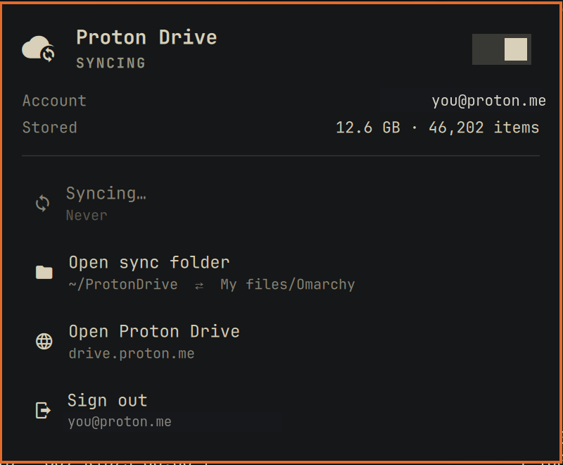

# Proton Drive for Omarchy

Proton Drive in the [Omarchy](https://omarchy.org/) bar: keep a folder on your
computer in two-way sync with a folder in Proton Drive, sign in, see storage
used and what the last syncs did. It is built on
[Proton's official Drive CLI](https://proton.me/download/drive/cli/index.html),
so your files are encrypted by Proton's own code end to end.



> Unofficial community plugin. Proton and Proton Drive are trademarks of
> Proton AG; this project is not affiliated with or endorsed by Proton AG.

## What it does

- **Two-way sync** between a local folder (default `~/ProtonDrive`) and a
  Drive folder (default `My files/Omarchy`), every 10 minutes while the
  switch is on, or on demand with **Sync now** (or right-click the bar icon).
- **Sign in** through Proton's own browser sign-in. Your session is kept by
  the CLI in your desktop keyring; this plugin never sees your password.
- **Install the CLI** with one click: it downloads Proton's official build
  for your CPU and checks it against the SHA-512 published on Proton's
  release page before installing it to `~/.local/bin/proton-drive`.
- **Storage used**, account, last sync, and a list of **recent activity**
  (click a file to show it in Files).
- Desktop notifications for conflicts and failed syncs.

## How sync stays safe

Proton's CLI uploads and downloads but has no sync engine, so this plugin
keeps a record of what both sides looked like after the last sync and
compares against it:

| Changed since last sync | What happens |
|---|---|
| only here | uploaded as a new revision (Drive keeps the old revisions) |
| only in Drive | downloaded and replaces the local copy |
| in both places, same content | nothing to do |
| in both places, different | **both kept**: the Drive version is saved beside yours as `name (Proton conflict DATE).ext`, on both sides |
| deleted here | moved to the **Proton Drive trash** |
| deleted in Drive | moved to your **desktop Trash** |

Nothing is ever deleted permanently. On top of that, a sync stops before
changing anything when:

- the remote folder cannot be read completely (network or sign-in trouble);
- the local folder is missing (an unmounted disk is not "delete everything");
- either side was emptied, or a sync would move more than 10 files (or a
  quarter of the folder) to the Trash.

When a sync stops for one of the last reasons, the panel offers **Sync and
allow deletions** so you can confirm it was intended.

Editors' temporary files (`.~lock.*`, `*.part`, `*.swp`, `~$*`, …) are not
synced. Proton Docs and Sheets are left in Drive, because the CLI cannot
download them as files.

## Install

Full walkthrough, troubleshooting and removal: **[docs/INSTALL.md](docs/INSTALL.md)**.

```bash
omarchy plugin add https://github.com/encelyte-llc/omarchy-proton-drive --enable
```

Then click the cloud icon in the bar:

1. **Install Proton Drive CLI** (skip if `proton-drive` is already on your PATH).
2. **Sign in to Proton Drive** and finish in the browser.
3. Turn on the switch at the top of the panel to start syncing.

To sync different folders, open Omarchy's bar settings for the widget and set
**Local folder** and **Proton Drive folder** (a path inside `/my-files`,
created if missing). Changing either starts a fresh sync record, so the
first sync after a change merges both sides without deleting anything.

## Settings

| Setting | Default | |
|---|---|---|
| Local folder | `~/ProtonDrive` | folder on this computer |
| Proton Drive folder | `/my-files/Omarchy` | must be inside `/my-files`; the whole Drive cannot be synced |
| Sync every (minutes) | 10 | 2 to 1440 |
| Status refresh (seconds) | 300 | how often storage and sign-in are checked |

## Keys

With the panel open: arrows to move, Enter to activate, `s` sync now, `o`
open the sync folder, `w` open Proton Drive on the web, `r` refresh, Tab to
switch panels. Bar icon: left click opens the panel, right click syncs, middle
click opens the folder.

## Good to know

- Each CLI call takes a few seconds (it talks to Proton's servers), so a sync
  of a folder with many subfolders takes a while. Folders are listed in
  parallel and transfers are batched per folder to keep it reasonable.
- Sync runs inside the Omarchy shell, so it pauses while you are logged out.
- State lives in `~/.local/state/omarchy-proton-drive/` (`state.json`,
  `last-sync.json`, `activity.jsonl`). Deleting `state.json` makes the next
  sync a fresh merge.

The helper can also be used from a terminal:

```bash
H=~/.config/omarchy/plugins/io.github.encelyte-llc.proton-drive/pdrive.py
python3 $H status
python3 $H sync --local ~/ProtonDrive --remote /my-files/Omarchy --dry-run
```

## Remove

```bash
omarchy plugin remove io.github.encelyte-llc.proton-drive
```

Your synced files stay where they are on both sides. To also remove the CLI
and its sign-in: `proton-drive auth logout && rm ~/.local/bin/proton-drive`.

## Development

```bash
python3 -m unittest discover tests   # sync engine against a fake Drive
node --test tests/                   # widget helpers and manifest
omarchy plugin validate .
```

## License

MIT
